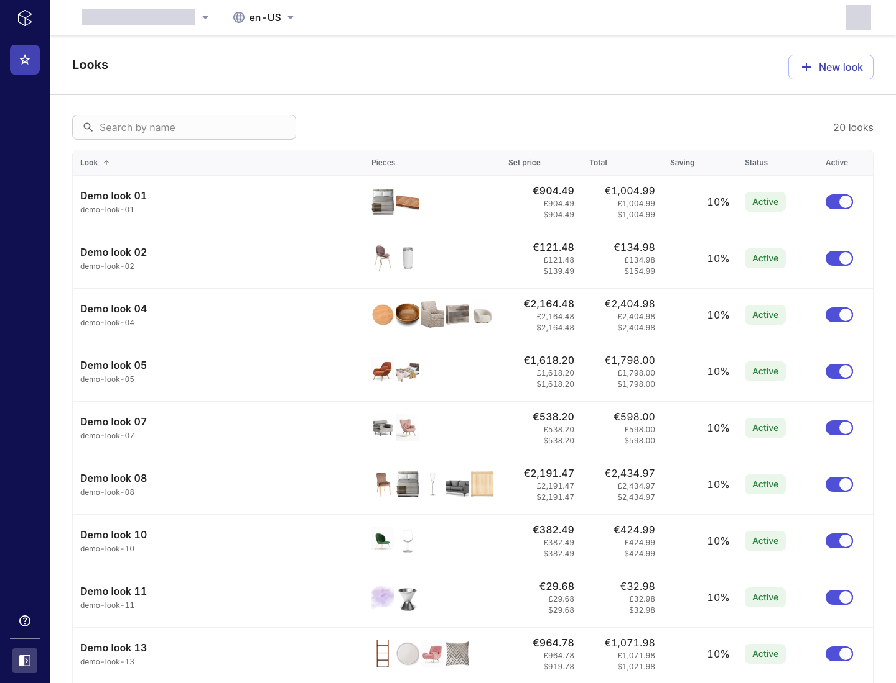
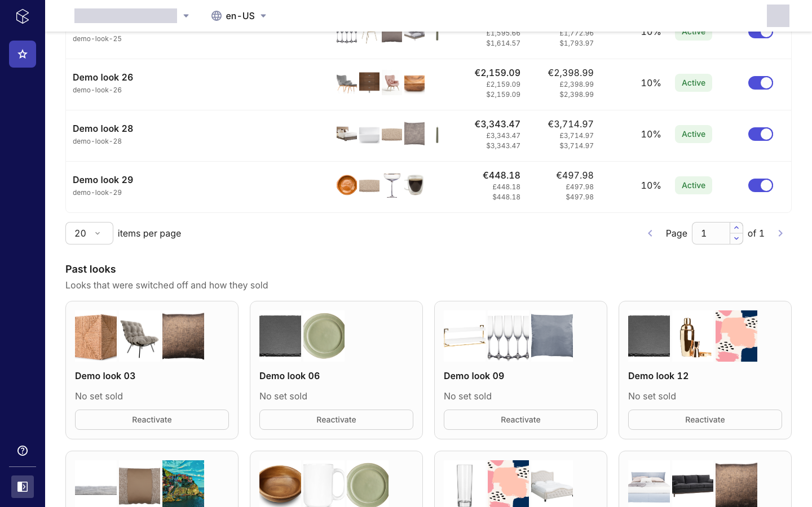
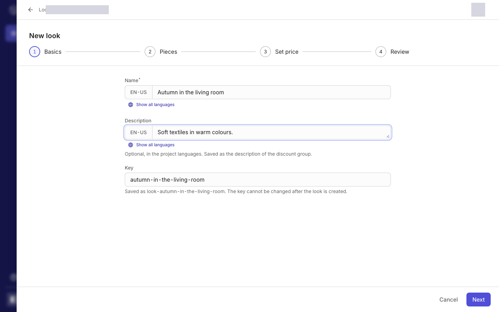
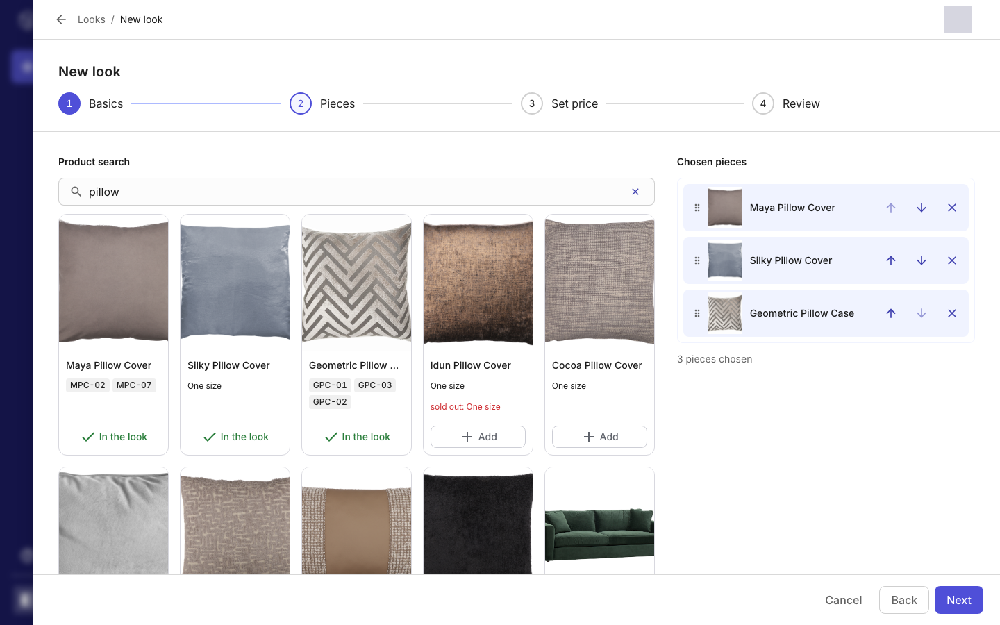
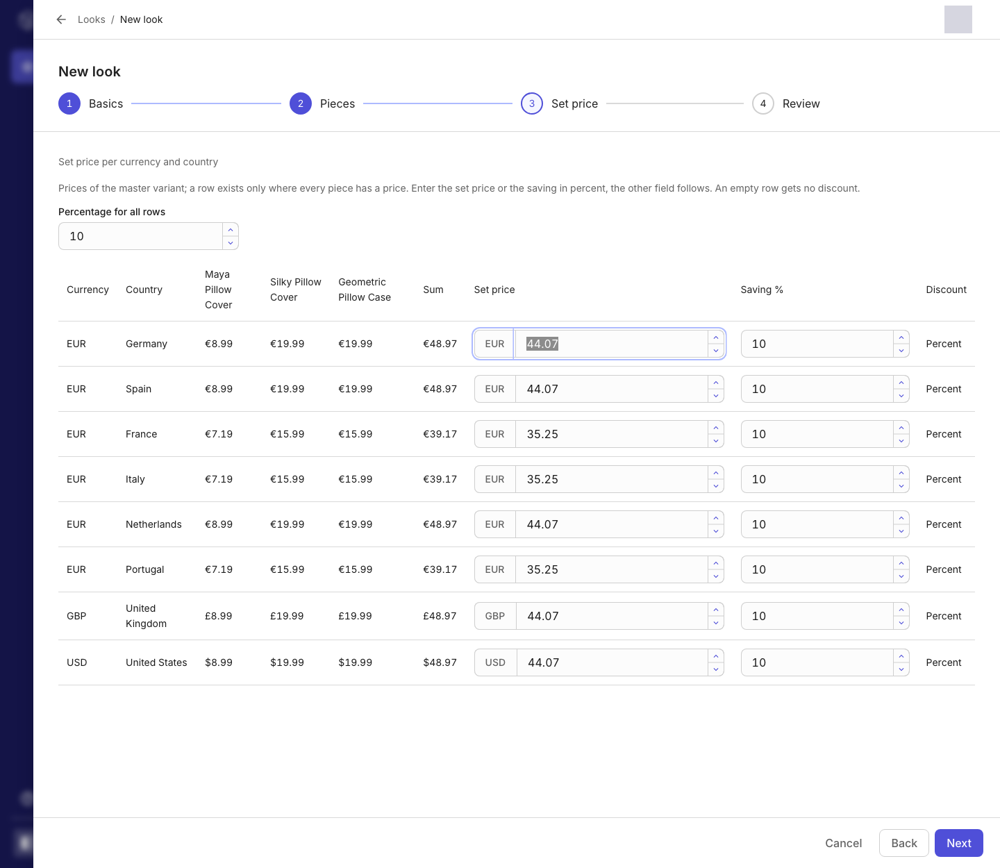
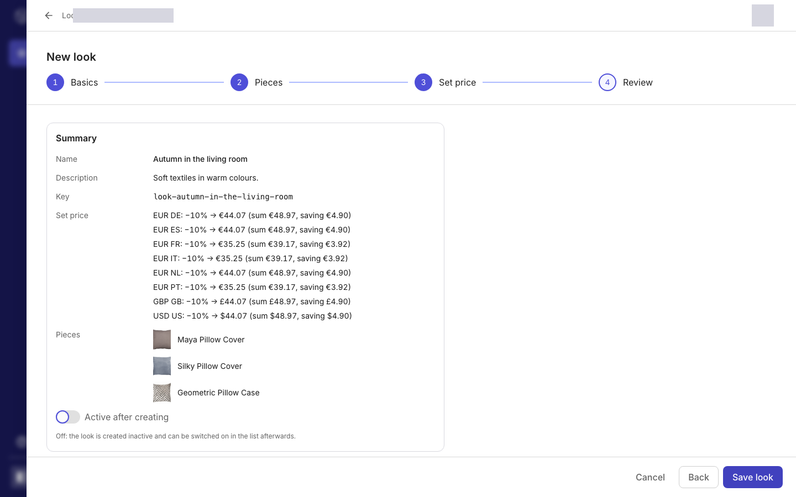
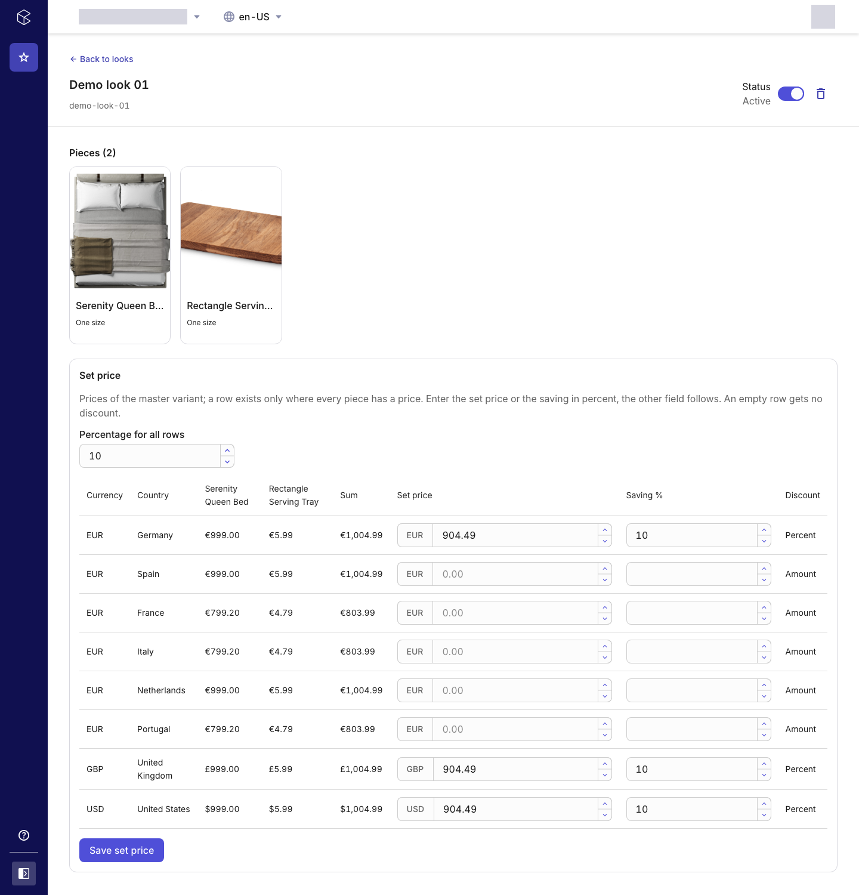
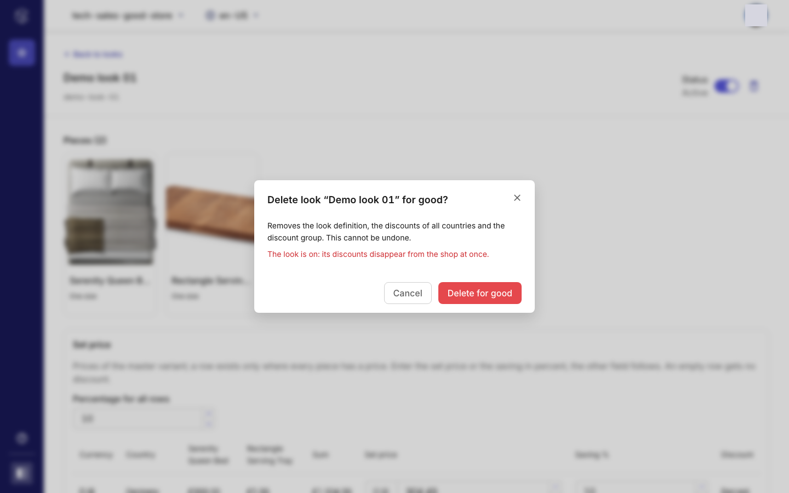

# Looks: features

Looks is a Merchant Center custom application for **curated looks**: at least two products sold as a set at a set price below the sum of their single prices. Merchandisers create, switch, reprice, inspect and delete looks without a ticket and without a deployment.

How it is built, in short: a look is a Custom Object `look-<key>` (container `look`), one Discount Group `look-<key>` and one Cart Discount per country that has set prices (all in that group). The discounts decide what shoppers pay. Details: [`specs/001-looks-app/spec.md`](./specs/001-looks-app/spec.md), setup: [`docs/SETUP.md`](./docs/SETUP.md).

## Looks list

- One row per look: name and key, the piece images (first five, then `+N`), set price, sum, saving, status.
- Status switch per row, plus the warnings "Unvollständig" (half-written look) and "Setpreis weicht ab" (price drifted).
- Search by look name, sorting by look, set price, sum, saving and status, pagination (20, 50, 100). Page, size, sort and search survive switching a look and coming back from a detail.
- Loading, empty, filtered-empty and error states with retry.

## Past looks ("Frühere Looks")

- Every complete look that is switched off, as a card with its pieces, active period and sales: sets sold, orders, revenue per currency, "Bester Look" badge.
- Sales come from the last 90 days of orders (up to 2000), read separately so a failing read never hides the list.
- "Wieder aktivieren" switches a look back on.

## Creating a look (four steps)

1. **Grunddaten**: the name in every project language (Nimbus localized field), an optional description the same way, and the look key (suggested from the English name, editable, checked for taken or invalid keys).

2. **Teile**: product search over name, description, slug, search keywords, key, product id and variant SKU; product tiles with size chips and "nur noch N" / "ausverkauft" hints; reorderable chosen pieces (drag or buttons); at least two pieces, no maximum; a warning, not a block, for a piece that is sold out everywhere.

3. **Setpreis**: a table with one row per currency and country in which every piece has a list price (master variant, valid now, never customer-group or channel prices). It shows each piece's price, the sum, the set price (money field) and the saving in percent (number field); both stay linked. The set price starts at the sum; an empty row creates no discount. A global percentage applies to all rows. A row edited by percent creates a **relative** discount, a row edited by price an **absolute** one (shown in the "Rabatt" column).

4. **Prüfen**: summary and the switch "Nach dem Anlegen aktiv" (off by default).

- The step is part of the URL (`/new`, `/new/pieces`, `/new/price`, `/new/review`): browser back and forward walk the steps, the list query is kept.
- Saving writes the discount group, the country discounts (inactive), the look definition and, if asked, the activation. It is resumable after a failure and never creates duplicates.

## Look detail

- Header: name, key, a two-line status with the switch, and a delete icon button; back link to the list with its query restored.
- The pieces as the same product tiles as in the creation flow, without the add action.
- Set-price table as in step 3 (prefilled from the look; the global percentage shows when all rows share one), saving only what changed; drift notice with "Setpreis neu berechnen".

- Delete: confirmation dialog (warns that an active look's discounts leave the shop at once); removes the country discounts, the main discount, the group and, last, the definition, so a half-deleted look can be deleted again.

## Repair

- A look that has only half of its resources shows "Unvollständig" and can be completed from the detail ("Vervollständigen"): the definition is rebuilt from the discounts, or the discounts and group are created from the definition. Completing never switches a discount on.

## Permissions, language, configuration

- Manage permission is required for every write; without it controls are disabled, never hidden. View is required to see the app at all.
- Every text exists in German and English (user language); look and product names follow the Merchant Center data locale.
- One developer setting, `VARIANT_ATTRIBUTES` (default `size`): the product-variant attributes that label a variant ("Beige / Leinen / 45x45"); several variants are always listed, by SKU when no attribute tells them apart.
- Currencies and languages are the project's. Product stock is read from the default inventory.
- Hosting from one bundle on Connect (production) or Netlify (development, preview).

## Screenshots

The images in `docs/screenshots/` come from sample looks in a commercetools sample project and are regenerated with the Playwright scripts in [`mc-looks-app/scripts/screenshots`](./mc-looks-app/scripts/screenshots) (the signed-in user's profile picture is masked).

## Not included

- Changing a look's name, description or key after it was created; duplicating a look.
- Seeding or sample data.
- Meta title and meta description in the product search (the product search API does not offer them).

## Known limits and open checks

- Platform limits: at most 100 active Cart Discounts without a code (each country discount counts) and 100 Discount Groups per project; both can be raised on request.
- Not yet confirmed against a live project: that the cart-discount scopes cover Discount Groups, and that the relative discount (`relativeCart`, `IndividualApplication`) is accepted for the set pattern (spec task T021).
